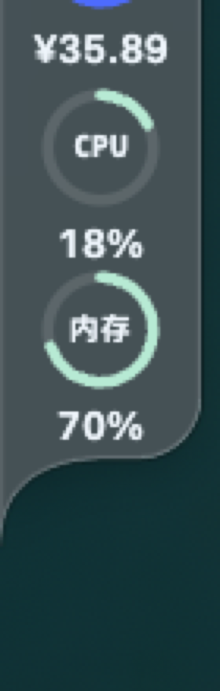
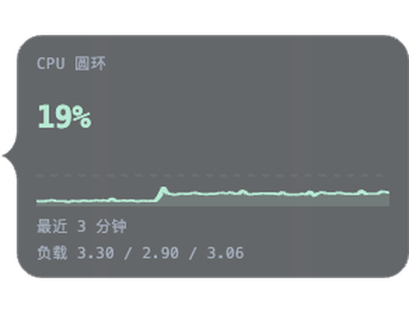
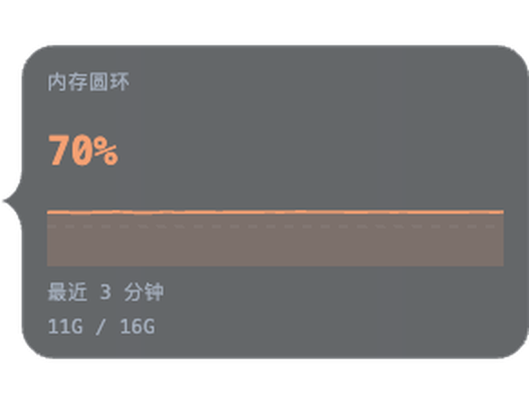

# System vitals（系统负载）

把 CPU 和内存做成 Token Monitor 边缘停靠栏（Edge Dock）上的额度环；悬停圆环可查看近期负载曲线和附加读数。

> Token Monitor 中文界面把 Edge Dock 叫作「侧边栏」，插件在中文界面显示为「系统负载」。本文统一写 Edge Dock，并附中文菜单名。
>
> English quick start: install Token Monitor ≥ 0.82.0 (macOS 13+ / Windows 10/11), then **Settings → Plugins → Install from file → Trust, install and enable**. Full runbook: [AGENTS.md](AGENTS.md).



## 兼容性

| 项目 | 要求 |
| --- | --- |
| Token Monitor | ≥ 0.82.0（`tmApi: 1`）；已在 0.85.0 / macOS arm64 实测 |
| macOS | 13+；Apple Silicon 已实测，Intel 未实测 |
| Windows | 10/11 x64；Edge Dock 可用，插件未实测 |
| Linux | **不支持本插件**：视图只声明 Edge Dock，而 Edge Dock 仅 macOS / Windows 提供 |
| 网络 | 插件不联网；下载 App 和 `.tmplugin` 需要访问 GitHub Releases |

Token Monitor 的插件 API 仍属实验性；本文在 0.85.0 上实测，更新的 0.8x 版本未逐一实测。App 升级后如果插件不兼容，优先升级插件；仍不兼容时，回滚插件或暂时使用兼容的 App 版本。

## 两步装好

本仓库是 [Token Monitor](https://github.com/Javis603/token-monitor) 的插件，不能单独运行。没装过 Token Monitor 也可以按下面两步从零完成；已经装好 ≥ 0.82.0 时直接看第 2 步。

### 第 1 步：安装 Token Monitor（≥ 0.82.0）

**macOS 13+（Apple Silicon / Intel）**

```bash
brew install --cask token-monitor
```

也可以从 [Token Monitor Releases](https://github.com/Javis603/token-monitor/releases/latest) 下载 `.dmg`。Homebrew 版本可能比 GitHub Releases 晚一两个版本，App 内置自动更新。

**Windows 10/11 x64**

从 [Releases](https://github.com/Javis603/token-monitor/releases/latest) 下载 `Token-Monitor-Setup-<version>.exe` 安装，或直接运行便携版 `Token-Monitor-<version>.exe`。

**Linux**

Token Monitor 本体支持 Linux，但本插件的视图只声明了 Edge Dock，而 Edge Dock 目前只在 macOS / Windows 提供。**Linux 上无法显示本插件**，不需要安装本插件；Token Monitor 本体仍可照常使用。

首次启动即是本地模式，不需要 hub。装好后确认版本不低于 `0.82.0`：

```bash
# macOS
/usr/libexec/PlistBuddy -c 'Print :CFBundleShortVersionString' "/Applications/Token Monitor.app/Contents/Info.plist"
```

```powershell
# Windows PowerShell（安装路径可能因安装选项不同，见详细指南）
(Get-Item "$env:LOCALAPPDATA\Programs\Token Monitor\Token Monitor.exe").VersionInfo.ProductVersion
```

低于 `0.82.0` 时先升级 App。需要免交互安装、指定安装目录、校验安装包或处理公司网络限制时，见 [从零部署指南](docs/install.md)。

### 第 2 步：安装 System vitals

1. 从 [Releases](https://github.com/swingmonkey/token-monitor-plugin-system-vitals/releases/latest) 下载最新的 `system-vitals-<version>.tmplugin`。当前为 `system-vitals-1.0.1.tmplugin`：

   <https://github.com/swingmonkey/token-monitor-plugin-system-vitals/releases/download/v1.0.1/system-vitals-1.0.1.tmplugin>

   同一个 Release 还提供 `SHA256SUMS`，可直接对照。

2. 校验下载文件（推荐）。把结果与 Release 资产显示的 SHA-256 对比：

   ```bash
   # macOS / Linux
   shasum -a 256 system-vitals-1.0.1.tmplugin
   ```

   ```powershell
   # Windows PowerShell
   Get-FileHash .\system-vitals-1.0.1.tmplugin -Algorithm SHA256
   ```

   当前版本的 SHA-256 以 Release 资产 digest 或随附的 `SHA256SUMS` 为准；比较时忽略 `sha256:` 前缀和大小写。

3. 打开 Token Monitor 主窗口，点右下角 ⚙ 打开设置，进入 **Plugins（插件）**。

4. 确认 **Enable plugins（启用插件）** 已打开（在 **More plugin actions（更多插件操作）** 菜单中）。如果看到 **Safe mode（安全模式）**，先完全退出 Token Monitor，再正常重新打开；如果 App 带 `--plugins-safe-mode` 启动或设置了 `TOKEN_MONITOR_PLUGINS_SAFE_MODE=1`，先移除它们。不要选「Restart without plugins / 不加载插件并重新启动」，那会再次进入安全模式。

5. 在 **Installed（已安装）** 页点击 **Install from file（从文件安装）**，选择刚下载的 `.tmplugin`。

6. 检查包名、版本、SHA-256 以及类型 / 后台运行说明，然后点 **Trust, install and enable（信任并安装启用）**。只想先安装、暂不运行代码时选 **Install only（只安装）**；选后者时插件会保持停用，之后打开它的开关会再次显示首次设置。

7. 在 **First-use settings（首次设置）** 中确认：
   - 保留 **CPU ring / Memory ring（CPU 圆环 / 内存圆环）** 的 Edge Dock 放置勾选（默认已勾选）；
   - 希望收起后仍持续采样时，保留 **Run in background（后台执行）**。

   确认后，两个圆环会自动加入 Edge Dock。

8. 如果 Edge Dock 还没打开：**Settings（设置）→ Window（窗口）→ Floating & Tray（浮窗与系统托盘）→ Edge Dock（侧边栏）** 勾选；也可以从菜单栏 / 系统托盘的 **Edge Dock（侧边栏）→ Show Edge Dock（显示侧边栏）** 打开。

9. 把鼠标移到屏幕边缘唤出 Edge Dock，悬停 CPU / 内存圆环查看卡片。

> Edge Dock 最多 24 项。首次设置时如果已满，放置会被跳过（不会挤掉已有项目）。移除一项后，到 **Plugins → System vitals（系统负载）→ Show on（显示位置）** 手动勾选 Edge Dock 即可。

## 验证

安装成功的标志：

- **Plugins → Installed** 中显示 **System vitals（系统负载）**，状态为 **On**，没有 **Problems（问题）**；
- 插件运行状态为 **Running**；若关闭了后台执行且当前没有可见视图，**Idle** 也是正常状态；
- Edge Dock 中出现 **CPU** 和 **内存 / MEM** 两个圆环，数值每 2 秒刷新；
- 悬停圆环可以看到大数字、近期曲线，以及 CPU 的系统负载均值或内存的 已用 / 总量。



## 使用

- 两个独立视图：**CPU 圆环** 与 **内存圆环**，可分别放置、排序或移除。
- 圆环弧长表示占用率，环内是指标名，环下是百分比；≥ 70% 变橙，≥ 90% 变红。
- 悬停卡片：大数字 + 近期负载曲线（固定 0–100 纵轴）+ 时间窗标题；CPU 卡附系统负载均值（1 / 5 / 15 分钟，Windows 不提供），内存卡附 已用 / 总量。
- 圆环与悬停卡片每 2 秒刷新一次。




## 数据与权限

- **本机采样**：CPU 通过 `os.cpus()` 差分；macOS 内存通过子进程调用系统自带的 `vm_stat`，按「实际可用页」计算（缓存 3 秒，1.5 秒超时；读取失败时沿用上一次成功读数）；Windows 使用 `os.freemem()` 兜底。
- **采样位置**：在插件的 Node 后端（Electron utility process）中运行，每 2 秒发布一次快照；开启后台执行后，Token Monitor 运行期间持续采样；退出 App 后采样停止。
- **历史范围**：后端保留 90 个采样点（每 2 秒一个，最多约 3 分钟）；CPU 曲线取最近 30 点（约 1 分钟），内存曲线取最近 60 点（约 2 分钟）。卡片标题按已积累的历史显示，缓冲满后可能显示 3 分钟。
- **不联网、不读凭证**：插件不访问网络，不读取凭证，不向设备外发送任何数据；历史曲线仅保存在内存中。
- **信任边界**：Token Monitor 插件并非沙盒。本插件只使用上述本机采样能力；安装前仍应像对待任何可信代码一样审查包内容。

## 更新

- **App**：Token Monitor 会自行检查并提示更新；macOS 也可 `brew upgrade --cask token-monitor`。
- **插件**：插件不会自动更新，也不跟随 App 自动更新。下载新的 `system-vitals-<version>.tmplugin` 后，按第 2 步重新导入；Token Monitor 会要求你重新确认信任（**Trust and update / 信任并更新**），已有的放置位置、后台执行和设置会保留。
- **回滚**：在插件卡片上点 **Settings（设置）→ Roll back（回滚）**，恢复上一版代码；数据迁移和插件在 App 外造成的影响不会被回滚。本插件没有持久化历史数据，历史曲线仅存在于内存。

## 卸载与恢复

- **停用**：Plugins → System vitals（系统负载）→ 关闭开关。后端会停止采样。
- **卸载**：在插件卡片上点 **Settings（设置）** 进入详情页 → **Uninstall（卸载）**；可选择保留插件数据和放置位置，方便以后重装。
- **界面卡死 / 插件异常**：使用菜单栏或系统托盘的 **Restart without plugins（不加载插件并重新启动）**，或以 `--plugins-safe-mode` 启动 Token Monitor；也可以设置环境变量 `TOKEN_MONITOR_PLUGINS_SAFE_MODE=1`。安全模式下可以管理插件，但不会加载插件界面和后端。

## 排错

| 现象 | 可能原因 | 处理 |
| --- | --- | --- |
| 点「从文件安装」没有反应 / 安装按钮不可用 | 插件总开关关闭，或处于安全模式 | 打开 **Enable plugins**；退出安全模式后重启 App |
| 导入时报 `incompatible-plugin-api` 或版本不兼容 | Token Monitor 低于 `0.82.0` | 升级 App 到最新稳定版 |
| 安装成功但 Edge Dock 没有圆环 | Edge Dock 总开关未开启 | 设置 → 窗口 → 浮窗与系统托盘 → Edge Dock（侧边栏） |
| 首次设置后只出现一个圆环 | 放置时 Edge Dock 已满（24 项） | 移除一项，再到 Plugins → System vitals → Show on 勾选 |
| 插件状态是 Off / Needs approval | 只安装了未启用，或更新后未重新信任 | 打开插件开关 / 点 **Review updated code（检查更新后的代码）** |
| 数值一直显示 `—` | 后端尚未完成第一次采样，或运行时未启动 | 等 2–5 秒；仍无读数时在插件卡片上点 **Settings（设置）→ Restart（重启）** |
| Windows 内存百分比和任务管理器不一致 | Windows 使用 `os.freemem()` 兜底，不统计缓存 / 可回收内存 | 预期行为；只有 macOS 使用 `vm_stat` 的可用页口径 |
| Linux 上找不到 Edge Dock / 无法放置 | 本插件只支持 Edge Dock，而 Edge Dock 仅 macOS / Windows 提供 | Linux 不支持本插件 |
| 圆环颜色不变化 | 未达到 70% / 90% 阈值 | 正常；阈值分别为橙色和红色 |
| macOS 内存读数短时间不变 | `vm_stat` 读取失败时沿用上一次成功读数（缓存 3 秒） | 通常几秒内恢复；持续异常时重启插件 |

更多平台命令、离线安装和完整排错见 [从零部署指南](docs/install.md)。

## 给 AI agent

如果你让 coding agent 代为部署，先让它阅读 [AGENTS.md](AGENTS.md)。里面有各平台的检查 / 下载 / 安装命令、必须由人确认的信任步骤、验证方法和失败处理。

可以直接把下面这段发给 agent：

```text
请阅读 https://github.com/swingmonkey/token-monitor-plugin-system-vitals/blob/main/AGENTS.md
按其中的步骤帮我安装或升级 Token Monitor 和 System vitals 插件。

要求：
1. 先检查操作系统、架构、Token Monitor 是否已安装及其版本；
2. 需要下载时，校验 .tmplugin 的 SHA-256；
3. 到「信任插件」这一步必须停下来让我在 Token Monitor 界面确认，不要修改 settings.json、不要直接往插件目录塞文件来绕过信任；
4. 安装后按 AGENTS.md 的验证步骤确认插件为 On 且 Edge Dock 出现两个圆环，再报告结果；
5. 如果你无法操作 GUI，就把需要我点击的步骤和验证项列出来，不要声称已经启用。
```

Token Monitor 没有提供用于安装或信任插件的命令行接口；信任确认必须由用户在 App 界面完成。任何声称能「静默信任」的做法都绕过了产品的安全检查，不应使用。

## License 与致谢

MIT License · 作者 [swingmonkey](https://github.com/swingmonkey)。灵感与环形视觉语言来自 Token Monitor 内置的额度环。
